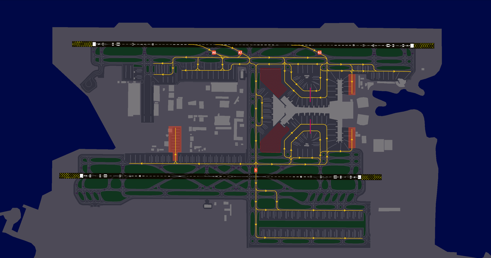
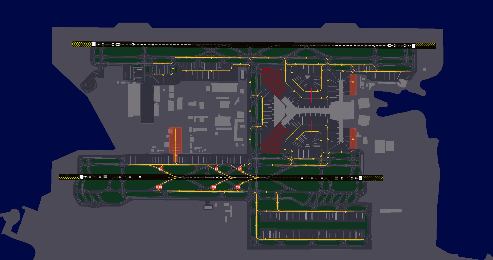
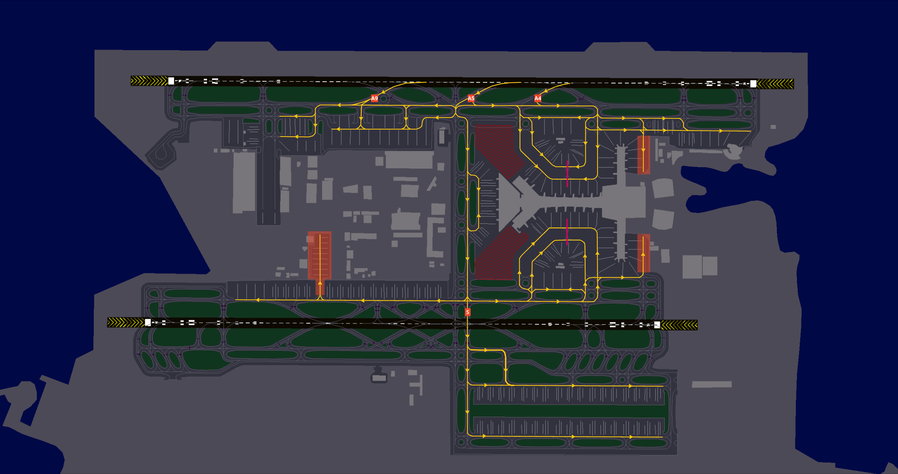

# Arriving Traffic
## STAR Assignment
STAR assignments are based on the waypoint at which you enter the Doha Terminal Maneuvering Area (TMA). ATC will assign the appropriate STAR depending on traffic conditions, with a preference for the shortest available routing whenever possible.

On first contact with ATC when entering the Doha FIR, report your **callsign, assigned flight level, and arrival ATIS letter**.

!!! note
    It is essential to highlight that arrival procedures are applicable to both Doha (OTBD) and Hamad (OTHH) airports. These procedures are not airport-specific.  

    Aircraft can be sequenced on either the east or west downwind, depending on sector capacity. Doha TMA STARs are designed as **open STARs** and normally end on the downwind. If you reach the clearance limit without further instructions, extend the downwind as published on the STAR chart and maintain the last assigned level.

The extended **trombone** segments provide linear holding and allow ATC to absorb delays and sequence traffic. During busy periods, expect to fly a substantial portion or the full STAR. When traffic permits, ATC may shorten the route by clearing you direct to a waypoint and advising the anticipated track miles to touchdown. A longer STAR may still be used off-peak for traffic, military activity, or airspace constraints.

!!! warning
    All STARs into Doha-Hamad include altitude and speed restrictions, which must be adhered to unless explicitly canceled by ATC. Pilots should verify clearance levels through instructions such as "**DESCEND VIA STAR**," "**DESCEND UNRESTRICTED**," or "**CANCEL STAR SPEEDS**."

## Runway Assignment
Runway assignments are issued by Doha Radar or Doha Approach and may be given with short notice during high-traffic periods. Pilots should be prepared for all arrival runways listed in the ATIS. The level at the end of the STAR normally indicates the intended runway:

- **2,500 ft:** RWY 16L/34R
- **3,500 ft:** RWY 16R/34L

ATC may assign a different altitude for tactical reasons and will advise the intended runway.

If the aircraft supports a secondary flight plan, pilots should preload an alternate arrival runway to facilitate a swift transition if required.

## Approach
The standard approach at Doha-Hamad is the ILS, with independent parallel operations in effect. Pilots can expect a minimum diagonal separation of 3 NM from traffic on the opposite runway and 2 NM spacing from preceding aircraft on the opposite runway.

During **Independent Parallel Operations (IPO)**, only ILS approaches are available. Monitor the arrival ATIS for the expected approach and mode of operation. Aircraft unable to accept an ILS should advise Doha Approach on first contact.

ATC monitors localiser tracking after glideslope intercept. If you deviate from the localiser while descending on the glideslope, follow any corrective instruction immediately; depending on the situation, you or traffic on the adjacent approach may be instructed to break off or go around.

## Expected Traffic Peaks

Traffic delays are most likely during the following UTC periods:

**Arrival peaks**
- 0100–0400 UTC
- 1300–1530 UTC
- 1800–2200 UTC

Check the arrival ATIS and current NOTAMs for operational updates. Actual track miles and delays may vary with traffic demand, weather, runway availability, and airspace restrictions.

## Speeds
The speed limits and recommended speeds within different segments of the Doha terminal area is as follows:

|  Speed Range  |              Arrival Segment              |
|:-------------:|:-----------------------------------------:|
| 230 - 210 kts |           Initial approach phase          |
|    180 kts    | Base leg/closed heading to final approach |
|    180 kts    |                Until 10 DME               |
|    160 kts    |                Until 4 DME                |

!!! note
    Aircraft subject to speed restrictions on final with DME constraints may be instructed by ATC to comply with "**STANDARD SPEEDS**" meaning pilots are expected to maintain these speeds until final approach.  

    For the A380, the speed sequence is as follows: 180 until 10 DME and 160 kts until 5 DME.

All STAR altitude and speed restrictions must be followed unless ATC explicitly cancels or amends them. Follow the meaning of your clearance carefully (for example, **DESCEND VIA STAR**, **DESCEND UNRESTRICTED**, or **CANCEL STAR SPEEDS**).

All speed restrictions must be adhered to as accurately as possible. Aircraft unable to comply with these restrictions must notify ATC in advance and specify the speeds they can maintain. Pilots should also inform ATC if circumstances require a speed adjustment for any reason.  

To ensure accurate spacing, pilots are requested to comply with speed adjustments as promptly as practicable, considering their operational constraints.  

If traffic sequencing does not require speed limitations, ATC will advise, “**NO ATC SPEED RESTRICTION**.”  

## Landing
### High Intensity Runway Operations (HIRO)
During peak traffic periods, rapid runway vacating is essential to prevent go-arounds for following aircraft. Ensure your entire aircraft has passed the designated runway holding point before considering yourself clear. Avoid unnecessary stops before exiting completely.

All rapid exit taxiways are equipped with rapid taxiway indicator lights. Pilots are encouraged to maintain the designated exit taxi speed of 50 knots.

| Runway |     Standard Rapid Exit   |
|:------:|:-------------------------:|
|   16L  |            A7             |
|   16R  |            M7             |
|   34L  |            M8             |
|   34R  |          **A9**           |

!!! warning
    Do not vacate the runway via A6 or L7 unless explicitly instructed by ATC.

!!! info
    Pilots are expected to vacate the runway using standard exit procedures unless instructed otherwise by the tower controller. If unable to comply with High-Intensity Runway Operations (HIRO), advise tower on first contact.

### ILS Glidepath Fluctuations
Aircraft arriving on Runway 34L may experience glidepath signal fluctuations due to taxiing and departing aircraft. Pilots should be prepared for potential glidepath interference and closely monitor their ILS profile, flight display indications, and autopilot behavior during both manual and coupled ILS approaches.

## Taxi
After landing, aircraft must not stop on the rapid exit taxiways and shall continue taxiing according to the following procedures unless otherwise instructed by the tower controller:  

| Runway | Taxi Route  |
|:------:|:----------------------:|
|   16L  |      Continue taxi via A6, hold short of C     |
|   16R  |    Continue via taxiway K or M southbound. If parking stand is planned on Apron 5, expect northbound turn on to taxiway K    |
|   34L  |    Continue via taxiway K or M southbound. If parking stand is planned on Apron 5, expect northbound turn on to taxiway K    |
|   34R  |      Continue taxi via A6, hold short of C     |

The following taxi diagrams depict the standard taxi routings. Note that it may be necessary for operational reasons to deviate from these routings and pilots should follow ATC instructions at all times.

### Runway 16s Configuration
#### Arrivals - Runway 16L

#### Arrivals - Runway 16R

### Runway 34s Configuration
#### Arrivals - Runway 34L

#### Arrivals - Runway 34R

